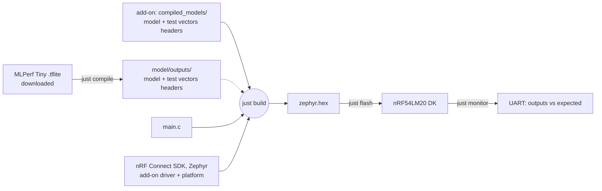

# axon-npu-demo

A Zephyr app that runs a neural network on the Axon NPU of the nRF54LM20B and checks the result.
It links a model compiled by Nordic's Axon compiler (a C header), runs inference on the test
vectors that come with it, and compares the output bytes with the expected ones.

The default model is `tinyml_kws`, one of the four [MLPerf Tiny](https://github.com/mlcommons/tiny)
models that the [Edge AI Add-on](https://github.com/nrfconnect/sdk-edge-ai) ships already compiled,
with three test vectors each. The app includes those headers from the add-on in the west
workspace. This repository contains no add-on file.

Tested on one nRF54LM20 DK, from macOS 26.5, with nRF Connect SDK v3.4.1 and add-on v3.0.0. Linux
is untested. Windows is not supported.



## Requirements

- nRF54LM20 DK (PCA10184) with the nRF54LM20B, board target `nrf54lm20dk/nrf54lm20b/cpuapp`. The nRF54LM20A has no NPU
- [`nrfutil`](https://docs.nordicsemi.com/bundle/nrfutil/page/guides/installing.html)
  with `nrfutil install sdk-manager device`
- [SEGGER J-Link](https://www.segger.com/downloads/jlink/) software, which `nrfutil device` needs
- [`just`](https://just.systems)
- Docker and `curl`, for `just compile` only
- Linux: [nrf-udev](https://github.com/NordicSemiconductor/nrf-udev) rules for
  the debug probe, and membership of the `dialout` and `docker` groups

`west.yml` pins the [Edge AI Add-on](https://github.com/nrfconnect/sdk-edge-ai)
at v3.0.0, which pulls nRF Connect SDK v3.4.1.

## Quick start

This repo is a west manifest: clone it into an empty directory and the SDK is checked out next to it.

```sh
mkdir axon-ws && cd axon-ws
git clone https://github.com/rdagher/axon-npu-demo.git && cd axon-npu-demo

just setup      # once: toolchain (~3 GB, installed by nrfutil) + SDK (~5 GB, into axon-ws/)
just build      # tinyml_kws
just flash
just monitor    # Ctrl-] to quit
```

See [Notes](docs/notes.md#workspace) to reuse an SDK or a workspace already on disk.

Expected output, after the boot banner (the vector lines and the summary repeat every 2 s):

```text
model tinyml_kws ready: 48 bytes out, 13548 bytes of workspace
vector 0: bit exact  5259 us  class 7 (STOP)
vector 1: bit exact  5259 us  class 2 (LEFT)
vector 2: bit exact  5255 us  class 6 (RIGHT)
3/3 outputs bit exact
```

The first line prints once at start-up: press RESET on the DK to see it. The first pass after a reset is about 90 µs slower.

The classes match the sample log in the add-on's `tests/axon/inference/README.rst`. `MISMATCH` replaces `bit exact` when the output differs from the expected vector.

## Default model

`tinyml_kws` is two headers of the add-on, written by the Axon compiler:

| File | Content |
|---|---|
| [`nrf_axon_model_tinyml_kws_.h`](https://github.com/nrfconnect/sdk-edge-ai/blob/v3.0.0/tests/axon/compiled_models/nrf_axon_model_tinyml_kws_.h) | The compiled model: an NPU command stream of 3,613 words, 22,064 B of weights and biases, and a descriptor with the shapes, the quantisation and the 12 labels |
| [`nrf_axon_model_tinyml_kws_test_vectors_.h`](https://github.com/nrfconnect/sdk-edge-ai/blob/v3.0.0/tests/axon/compiled_models/nrf_axon_model_tinyml_kws_test_vectors_.h) | Three test vectors: for each, an input of 490 B (49 x 10 `int8`) and the expected output of 48 B (12 `int32`) |

Both stay in flash. The model also needs 13,548 B of RAM, the interlayer buffer. See [Models](docs/models.md) for the other three models and the symbols of the header.

## Bench

[`bench/`](bench/README.md) is a second app. It measures the four MLPerf Tiny models with a [Power Profiler Kit II](https://www.nordicsemi.com/Products/Development-hardware/Power-Profiler-Kit-2) (PPK2), [zephyr-ppk2](https://github.com/rdagher/zephyr-ppk2) and [ppk2-lib](https://github.com/rdagher/ppk2-lib), on the NPU and on the CPU with TensorFlow Lite Micro (TFLM):


On the NPU an inference takes 5.6 to 16.1 times less time and 3.9 to 13.8 times less charge than with TFLM on the same chip. See [bench/README.md](bench/README.md) for the figures, what they include and their limits.

## Documentation

- [Models](docs/models.md): the other three models, the build sizes, and the content of a compiled model header.
- [Compiling a model](docs/compiling.md): `just compile`, from a `.tflite` to the headers.
- [Runtime flow](docs/runtime.md): the driver calls of `app/src/main.c`, what an app needs to use the NPU, and the add-on files to read.
- [Bench](bench/README.md): the measurements, their limits and how to reproduce them.
- [Notes](docs/notes.md): what the recipes, the compiler and the build system need.

## Licence

[Apache-2.0](LICENSE). The nRF Connect SDK, the add-on and the models are not in this repository. See [Licences](docs/licences.md) for theirs.
