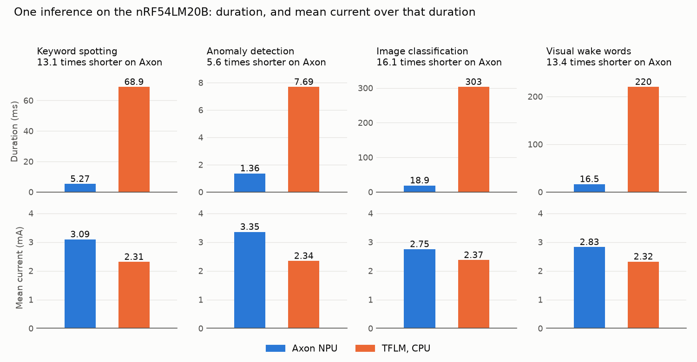

# axon-npu-demo

Two Zephyr apps for the Axon NPU of the nRF54LM20B, on the nRF54LM20 DK:

- [`app/`](app/README.md) runs a model compiled by Nordic's Axon compiler on the test vectors that come with it, and compares the output bytes with the expected ones.
- [`bench/`](bench/README.md) measures the time and the current of an inference with a [Power Profiler Kit II](https://www.nordicsemi.com/Products/Development-hardware/Power-Profiler-Kit-2) (PPK2), on the NPU and on the CPU with TensorFlow Lite Micro (TFLM).

The models are the four of [MLPerf Tiny](https://github.com/mlcommons/tiny). The [Edge AI Add-on](https://github.com/nrfconnect/sdk-edge-ai) ships them compiled, with three test vectors each, and the app includes those headers from the west workspace. This repository contains no add-on file.



On the NPU an inference is 5.6 to 16.1 times shorter, at a mean current 0.4 to 1.0 mA higher. Its charge is 3.9 to 13.8 times lower. See [bench/README.md](bench/README.md) for the measurement and its limits.

## Requirements

- nRF54LM20 DK (PCA10184) with the nRF54LM20B; the nRF54LM20A has no NPU
- [`nrfutil`](https://docs.nordicsemi.com/bundle/nrfutil/page/guides/installing.html)
  with `nrfutil install sdk-manager device`
- [SEGGER J-Link](https://www.segger.com/downloads/jlink/) software, which `nrfutil device` needs
- [`just`](https://just.systems)
- Docker and `curl`, for `just compile` only
- Linux: [nrf-udev](https://github.com/NordicSemiconductor/nrf-udev) rules for
  the debug probe, and membership of the `dialout` and `docker` groups

`west.yml` pins the [Edge AI Add-on](https://github.com/nrfconnect/sdk-edge-ai)
at **v3.0.0**, which pulls nRF Connect SDK **v3.4.1**.

## Quick start

This repo is a west manifest: clone it into an empty directory and the SDK is checked out next to it.

```sh
mkdir axon-ws && cd axon-ws
git clone https://github.com/rdagher/axon-npu-demo.git && cd axon-npu-demo

just setup      # once: toolchain (~3 GB, installed by nrfutil) + SDK (~5 GB, into axon-ws/)
just build      # tinyml_kws
just flash
just monitor    # Ctrl-] to quit
```

Expected output, after the boot banner (the vector lines and the summary repeat every 2 s):

```
model tinyml_kws ready: 48 bytes out, 13548 bytes of workspace
vector 0: bit exact  5259 us  class 7 (STOP)
vector 1: bit exact  5259 us  class 2 (LEFT)
vector 2: bit exact  5255 us  class 6 (RIGHT)
3/3 outputs bit exact
```

The first line prints once at start-up: press RESET on the DK to see it. The first pass after a reset is about 90 µs slower.

The classes match the sample log in the add-on's `tests/axon/inference/README.rst`. `MISMATCH` replaces `bit exact` when the output differs from the expected vector.

## Details

- See [app/README.md](app/README.md) for the other models, the compiler's output, the driver calls of the app and the add-on files to read.
- See [bench/README.md](bench/README.md) for the measurements: the tables, the figures, the method and how to reproduce them.

## Licence

| Files | Licence |
|---|---|
| Everything in this repository | [Apache-2.0](LICENSE) |
| nRF Connect SDK, Edge AI Add-on | Not in this repository. `west` fetches them under their own licences: Nordic's 5-Clause licence, which restricts use to Nordic devices, for the add-on, sdk-nrf and nrfxlib; Apache-2.0 for Zephyr; others for the remaining modules. The compiled models and test vectors are part of the add-on |
| MLPerf Tiny `.tflite` models | Not in this repository. `just compile` downloads them from [mlcommons/tiny](https://github.com/mlcommons/tiny), which is Apache-2.0. Each was trained on a public dataset named in its folder of that repository (Speech Commands v2 for keyword spotting, released under CC BY 4.0 according to [its paper](https://arxiv.org/abs/1804.03209)); the licences of the other three datasets were not checked here |
