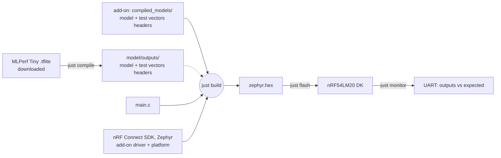

# Inference app

The app links a model compiled by Nordic's Axon compiler, runs it on the test vectors that come
with it, and compares the output bytes with the expected ones. This page describes the models, the
compiler's output, the driver calls and the add-on files behind it. See the
[top-level README](../README.md) for the requirements and the quick start.



## Models

```sh
just build tinyml_ad     # anomaly detection, no class line
just build tinyml_ic     # image classification
just build tinyml_vww    # visual wake words
```

Build sizes on add-on v3.0.0. RAM includes the 52,224 B interlayer buffer, flash the three test vectors:

| Model | Input | Output | Interlayer buffer needed | Flash | RAM |
|---|---:|---:|---:|---:|---:|
| `tinyml_kws` | 490 B | 48 B | 13,548 B | 85,028 B | 60,032 B |
| `tinyml_ad` | 640 B | 2,560 B | 2,688 B | 323,396 B | 62,376 B |
| `tinyml_ic` | 3,072 B | 40 B | 52,224 B | 172,320 B | 60,016 B |
| `tinyml_vww` | 27,648 B | 8 B | 46,080 B | 389,256 B | 59,952 B |

## Compiling a model

```sh
just compile                          # needs Docker
just build mlperf_kws model/outputs
```

`just compile`:

1. downloads the four reference models from [mlcommons/tiny](https://github.com/mlcommons/tiny/tree/4addd0fa08d216e20637637874e084895f289da4/benchmark/training) at a pinned commit and checks their SHA-256,
2. writes three random inputs per model with [`model/make_test_data.py`](../model/make_test_data.py), run inside the compiler image,
3. runs the Axon compiler (Docker image built from the add-on) on [`model/axon.yaml`](../model/axon.yaml).

The compiler writes to `model/outputs/`, which is not committed. For `mlperf_kws`, and likewise for `mlperf_ad`, `mlperf_ic` and `mlperf_vww`:

| File | Content |
|---|---|
| `nrf_axon_model_mlperf_kws_.h` | the compiled model |
| `nrf_axon_model_mlperf_kws_test_vectors_.h` | the three inputs and the outputs the compiler computed for them on the host |
| `nrf_axon_model_mlperf_kws_layers_.h` | per-layer models, not used here |
| `nrf_axon_model_mlperf_kws_test_inference_labels_.csv` | the same expected outputs as CSV, not used here |

The result is not the add-on's `tinyml_kws`: same layers and sizes, different weights, and `int8` outputs (12 B) where the add-on's header has `int32` (48 B). The inputs are random, so the printed classes mean nothing; only the bit-exact check does.

## Axon compiler output

The compiler writes `nrf_axon_model_<name>_.h` (the model), `..._test_vectors_.h` and `..._layers_.h`. The add-on's four can be read online:

| Model | Compiled model | Test vectors |
|---|---|---|
| `tinyml_kws` | [`nrf_axon_model_tinyml_kws_.h`](https://github.com/nrfconnect/sdk-edge-ai/blob/v3.0.0/tests/axon/compiled_models/nrf_axon_model_tinyml_kws_.h) | [`nrf_axon_model_tinyml_kws_test_vectors_.h`](https://github.com/nrfconnect/sdk-edge-ai/blob/v3.0.0/tests/axon/compiled_models/nrf_axon_model_tinyml_kws_test_vectors_.h) |
| `tinyml_ad` | [`nrf_axon_model_tinyml_ad_.h`](https://github.com/nrfconnect/sdk-edge-ai/blob/v3.0.0/tests/axon/compiled_models/nrf_axon_model_tinyml_ad_.h) | [`nrf_axon_model_tinyml_ad_test_vectors_.h`](https://github.com/nrfconnect/sdk-edge-ai/blob/v3.0.0/tests/axon/compiled_models/nrf_axon_model_tinyml_ad_test_vectors_.h) |
| `tinyml_ic` | [`nrf_axon_model_tinyml_ic_.h`](https://github.com/nrfconnect/sdk-edge-ai/blob/v3.0.0/tests/axon/compiled_models/nrf_axon_model_tinyml_ic_.h) | [`nrf_axon_model_tinyml_ic_test_vectors_.h`](https://github.com/nrfconnect/sdk-edge-ai/blob/v3.0.0/tests/axon/compiled_models/nrf_axon_model_tinyml_ic_test_vectors_.h) |
| `tinyml_vww` | [`nrf_axon_model_tinyml_vww_.h`](https://github.com/nrfconnect/sdk-edge-ai/blob/v3.0.0/tests/axon/compiled_models/nrf_axon_model_tinyml_vww_.h) | [`nrf_axon_model_tinyml_vww_test_vectors_.h`](https://github.com/nrfconnect/sdk-edge-ai/blob/v3.0.0/tests/axon/compiled_models/nrf_axon_model_tinyml_vww_test_vectors_.h) |

For `tinyml_kws`:

| Symbol | Where | What |
|---|---|---|
| `cmd_buffer_tinyml_kws[]` | flash | NPU command stream, 3,613 words |
| `axon_model_const_tinyml_kws` | flash | weights and biases, 22,064 B |
| `model_tinyml_kws` | flash | descriptor: buffer pointers, I/O shapes, quantisation, labels |

The header also states the RAM the model needs for its activations, the interlayer buffer (`NRF_AXON_MODEL_TINYML_KWS_MAX_IL_BUFFER_USED`; the app prints it as "workspace"). That RAM is not inside the NPU: it is the global array `nrf_axon_interlayer_buffer`, defined in the add-on's Zephyr platform file and sized by `CONFIG_NRF_AXON_INTERLAYER_BUFFER_SIZE` in `prj.conf`. The same buffer holds the model's input and output. The header fails to compile if the buffer is too small.

## Runtime flow

See [`src/main.c`](src/main.c):

1. `nrf_axon_platform_init()`: IRQ, power and locking for the NPU.
2. `nrf_axon_nn_model_init_vars()` resets the model's persistent variables (these models have none).
   `nrf_axon_nn_model_validate()` checks that the interlayer buffer is large enough and the driver recent enough.
   The app also refuses a model with several inputs or outputs.
3. `nrf_axon_nn_model_infer_sync(&model, in, out)` powers the NPU on, takes its lock and copies `in` into the interlayer buffer.
   It hands the command stream to the NPU and sleeps until the completion interrupt.
   Then it copies the result to `out` and powers the NPU off.
4. `nrf_axon_nn_get_classification()`: index and label of the highest output.

Not every layer runs on the NPU: the command streams of the three classifiers end with a softmax computed on the CPU, in `drivers/axon/nrf_axon_nn_op_extensions.c`.

An application needs three things to use the NPU: `CONFIG_NRF_AXON=y` and `CONFIG_NRF_AXON_INTERLAYER_BUFFER_SIZE` in `prj.conf`, and the `axon` node enabled in a devicetree overlay (`boards/`), since it is disabled by default.

## Add-on files

| Path under `edge-ai/` | Content |
|---|---|
| `include/drivers/axon/`, `include/axon/` | public headers |
| `drivers/axon/nrf_axon_nn_infer.c` | inference entry points (source provided) |
| `lib/axon/platform/src/zephyr/nrf_axon_platform_zephyr.c` | OS glue: IRQ, semaphores, power, interlayer buffer |
| `lib/axon/bin/arm/libnrf-axon-driver-internal.a` | NPU driver core (prebuilt) |
| `tools/axon/compiler/` | compiler (Docker) |
| `tests/axon/compiled_models/` | the compiled models and test vectors used here |
| `tests/axon/inference/` | Nordic's own test app for these models |
| `samples/axon/hello_axon/` | Nordic's own minimal sample |

References:
- [Edge AI Add-on](https://nrfconnectdocs.nordicsemi.com/addons/addon-edge-ai/3.0.0/),
- [Axon compiler](https://github.com/nrfconnect/sdk-edge-ai/blob/v3.0.0/doc/axon_compiler/Axon_npu_tflite_compiler.rst),
- [MLPerf Tiny models on Axon](https://github.com/nrfconnect/sdk-edge-ai/blob/v3.0.0/doc/axon_compiler/mlperf_tiny_models.rst),
- [supported operators](https://github.com/nrfconnect/sdk-edge-ai/blob/v3.0.0/doc/axon_compiler/supported_operators.rst).

## Workspace

If nRF Connect SDK v3.4.1 is already on disk, let west clone from it
instead of downloading (`--path-cache`, see `west update --help`):

```sh
just setup --path-cache /opt/nordic/ncs/v3.4.1
```

`just setup` can be run again after an interrupted download.

To reuse an existing add-on v3.0.0 workspace instead, skip `just setup`, install the toolchain
(`nrfutil sdk-manager toolchain install --ncs-version v3.4.1`) and prefix the other recipes:
`AXON_WS=/path/to/workspace just build`.

## Notes

- `just flash` and `just monitor` use the only J-Link kit attached. With several, they stop and ask for `DK_SERIAL=<serial number>`, as listed by `nrfutil device list`.
- The compiler in add-on v3.0.0 (Axon compiler v2.0.1) fails without the `classification_labels` key in [`model/axon.yaml`](../model/axon.yaml). A model without classes, like anomaly detection, takes the key empty and no `test_labels`.
- The compiler writes the test vectors header only with `test_data` and `header_file_test_vector_cnt` above 0; the default is 0.
- The `us` column is the time of one `nrf_axon_nn_model_infer_sync()` call, measured with `k_cycle_get_32()` (1 µs resolution). It includes NPU power-up and locking, the input copy, the NPU run, any CPU layer, the output copy and power-down.
- Tested on macOS. Linux is untested; Windows is not supported (`flash` and `monitor` need `bash`).
- A model header defines its data, so it can be included in one C file only.
- `just build` passes `-DAXON_MODEL` and `-DAXON_MODEL_DIR` to CMake; `CMakeLists.txt` reads them with `zephyr_get()`, since a plain cache variable does not reach the app image under sysbuild.
- Paths containing spaces are not supported by the SDK's build system.
