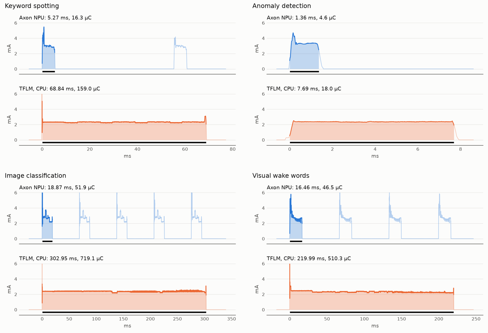

# Bench of the Axon NPU against TFLM

A second app that measures the time, the current and the charge of one inference on the
nRF54LM20B. It runs the four [MLPerf Tiny](https://github.com/mlcommons/tiny) reference models two
ways, from the same `.tflite`:

| Backend | How the model runs |
|---|---|
| Axon | Compiled by Nordic's [Axon compiler](https://github.com/nrfconnect/sdk-edge-ai/blob/v3.0.0/doc/axon_compiler/Axon_npu_tflite_compiler.rst), run on the NPU |
| TFLM | [TensorFlow Lite Micro](https://github.com/tensorflow/tflite-micro) with [CMSIS-NN](https://github.com/ARM-software/CMSIS-NN) kernels, run on the Cortex-M33 at 128 MHz |

A [Power Profiler Kit II](https://www.nordicsemi.com/Products/Development-hardware/Power-Profiler-Kit-2)
(PPK2) captures the current. [zephyr-ppk2](https://github.com/rdagher/zephyr-ppk2) marks the
inference in the firmware and reports it. [ppk2-lib](https://github.com/rdagher/ppk2-lib) drives
the PPK2.

Measured on one dev kit with one PPK2. See [Limitations](#limitations) for what was not checked.

## Results

Measured on one nRF54LM20 DK with one PPK2, in Ampere meter mode at the kit's current-measurement
header, at 100,000 samples per second. The kit's supply voltage is set to 3.3 V in the
[Board Configurator](https://docs.nordicsemi.com/bundle/nrf-connect-board-configurator/page/index.html)
app, and the captures are given `--vdd 3.3`. Each capture starts from a power cycle.

| Model | Backend | Time | Mean current | Charge, median | Inferences per mAh | Charge, mean ± sd | Regions |
|---|---|---:|---:|---:|---:|---:|---:|
| Keyword spotting | Axon | 5.279 ms | 3,343 µA | 16.5 µC | 217,800 | 17.6 ± 2.1 µC | 207 |
|  | TFLM | 68.988 ms | 2,303 µA | 158.859 µC | 22,700 | 158.867 ± 0.098 µC | 205 |
| Anomaly detection | Axon | 1.366 ms | 3,403 µA | 4.58 µC | 786,700 | 4.65 ± 0.35 µC | 222 |
|  | TFLM | 7.714 ms | 2,308 µA | 17.776 µC | 202,500 | 17.803 ± 0.074 µC | 422 |
| Image classification | Axon | 18.897 ms | 2,725 µA | 51.44 µC | 70,000 | 51.49 ± 0.57 µC | 166 |
|  | TFLM | 303.865 ms | 2,352 µA | 714.77 µC | 5,000 | 714.81 ± 0.33 µC | 69 |
| Visual wake words | Axon | 16.465 ms | 2,822 µA | 46.53 µC | 77,400 | 46.46 ± 0.58 µC | 172 |
|  | TFLM | 220.903 ms | 2,278 µA | 503.23 µC | 7,200 | 503.21 ± 0.23 µC | 90 |

A region is one inference: the stretch where the marker is high. "mean ± sd" is the mean and the
standard deviation of the charge over the regions of one capture.

The charge is what one inference draws from the supply. One mAh is 3,600,000 µC, so the
inferences per mAh are that number divided by the median charge. They count the inference alone,
not the sleep between two inferences or anything else the application does.

| Model | Time, TFLM / Axon | Charge, TFLM / Axon |
|---|---:|---:|
| Keyword spotting | 13.1 | 9.6 |
| Anomaly detection | 5.6 | 3.9 |
| Image classification | 16.1 | 13.9 |
| Visual wake words | 13.4 | 10.8 |

The charge ratio is computed from the median charges.


Each panel has its own scale. The charge is the median over the regions.



Each pair of panels shows one inference of a model, on the NPU and on the CPU, on the same scales.
The samples are raw, at 100,000 per second. The shaded area is the charge and the black bar is the
marker. The inference drawn is the one with the median charge, so its duration and charge match the table. The lighter pulses after an Axon inference are the next ones.

The current axis stops at 10 mA. Where samples leave it, the panel gives the peak. Those peaks,
and the spike at the start of each Axon inference, come from the PPK2 at a wake-up, as described
under [Measurement](#measurement). Back to back, with no wake-up, the highest sample of an Axon
inference is 4.3 to 4.8 mA for three of the four models.

While it runs, the NPU raises the mean current of the chip by 0.4 to 1.1 mA over the CPU alone.
The inference is 5.6 to 16.1 times shorter, so the charge is lower.

Between two inferences the firmware sleeps for 50 ms. The median current there is 1.44 to 1.49 µA
in the eight captures.

The figures come from [`results/*.txt`](results), as printed by `west ppk2 attribute`. The
captures themselves, 47 to 105 MB each, are not in the repository.

## Comparison with Nordic's figures

Nordic publishes the inference time, the average current at 3 V and the energy of the same four
models on its [Axon NPU](https://www.nordicsemi.com/Products/Technologies/Edge-AI/Axon-NPU) page.
Its energy is the time multiplied by the current and by 3 V. The page does not describe how the
time and the current were measured. The nRF54LM20B
[datasheet](https://docs.nordicsemi.com/r/bundle/ps_nrf54lm20a/page/elspec.html-unique_487521905)
gives the same four currents as typical values, under `IAXONS0` to `IAXONS3`. The table below
gives the figures of the page as read on 25 November 2026.

To compare, the kit was set to 3.0 V and the four models were captured again on the NPU, back to
back: the firmware stays awake for 100 µs between two inferences, with no sleep. The figures
below are computed as Nordic's: the average current is the median charge divided by the time, and
the energy is the time multiplied by that current and by 3 V.

| Model | Time, Nordic | Time, here | Current, Nordic | Current, here | Energy, Nordic | Energy, here |
|---|---:|---:|---:|---:|---:|---:|
| Keyword spotting | 4.5 ms | 5.263 ms | 3.0 mA | 3.29 mA | 40.5 µJ | 51.9 µJ |
| Anomaly detection | 1.3 ms | 1.355 ms | 3.5 mA | 3.56 mA | 13.7 µJ | 14.5 µJ |
| Image classification | 17.9 ms | 18.850 ms | 2.7 mA | 2.94 mA | 145 µJ | 166.2 µJ |
| Visual wake words | 14.4 ms | 16.432 ms | 2.8 mA | 3.04 mA | 121 µJ | 150.0 µJ |

With Nordic's figure as the reference, the time is 4 to 17 % longer here, the current 0.06 to
0.29 mA higher, and the energy 5 to 28 % higher.

On the CPU, Nordic gives a time only: 70, 7, 303 and 223 ms. The times of [Results](#results),
measured at 3.3 V, are within 1.4 % of them for three models, and 10 % longer for anomaly
detection. The charge on the CPU and the charge ratios are measured here only.

Two conditions were tested, and neither explains the longer times:

- The supply voltage. From 3.3 V to 3.0 V the time of each model stays within 48 µs, and the
  charge rises by 6 to 9 %.
- The wake-up from sleep. Back to back, the time stays within 7 µs, and the charge falls by
  0.7 to 2.5 %.

The time measured here agrees with Nordic's own test log. The add-on's
[inference test](https://github.com/nrfconnect/sdk-edge-ai/blob/v3.0.0/tests/axon/inference/README.rst)
prints 5,213 ticks at 1,000,000 ticks per second for one keyword-spotting inference, which is
5.2 ms. The log covers keyword spotting only, so the other three models are not checked this way.
The cause of the difference with the 4.5 ms of the page is not established.

The reports of these eight captures are in [`results/3v0/`](results/3v0). To capture one, set the
kit to 3.0 V in the Board Configurator and run:

```sh
VDD=3.0 BENCH_GAP_MS=0 just measure axon mlperf_kws 12
```

## Measurement

- The marker is raised just before the inference call and dropped just after it:
  `PPK2_TRACE_SCOPE` in [`src/main.c`](src/main.c). The time and the charge cover the whole device under test (DUT) while the marker is high.
- Axon: one `nrf_axon_nn_model_infer_sync()` call. It includes NPU power-up and locking, the
  input copy, the NPU run, the softmax on the CPU where the model has one, the output copy and
  power-down.
- TFLM: the input copy, `Invoke()` and the output copy.
- The median of the charge is used, not the mean. When the DUT wakes from sleep, the PPK2 can
  read tens of mA too high for 40 µs, which moves the mean of a short region. See zephyr-ppk2's
  [limitations](https://github.com/rdagher/zephyr-ppk2/blob/main/docs/limitations.md#wake-up-bursts).
- No energy is given. A PPK2 measures current, and the charge follows from it with no assumption.
  To give an energy, the supply voltage is required, and the capture does not contain it. At a constant voltage
  the energy ratio is the charge ratio. [MLPerf Tiny](https://github.com/mlcommons/tiny) reports the
  energy per inference: here it is the charge times 3.3 V, the supply voltage set on the kit.
- The measurement firmware has no UART: [`quiet.conf`](quiet.conf).

## Output check

Both backends must give the output the Axon compiler expects, within a tolerance. The firmware
compares each output with the expected one. It stops raising the marker when a value differs by
more than 2 of 255 (`CONFIG_BENCH_TOLERANCE`), so a wrong inference is not measured. The `verify`
build prints the largest difference of each inference.

Largest difference on the dev kit, over the three test vectors:

| Model | Axon | TFLM |
|---|---:|---:|
| Keyword spotting | 0 | 2 |
| Anomaly detection | 0 | 2 |
| Image classification | 0 | 1 |
| Visual wake words | 0 | 0 |

Axon is bit exact. TFLM is not: it rounds differently. To see by how much on the
host, where TFLite runs the same `.tflite` on the same test vectors, run `just check`. Docker and the models compiled by `just compile` are required. The command fails above the same tolerance:

```console
$ just check
mlperf_kws: largest difference 2 of 255
mlperf_ad: largest difference 1 of 255
mlperf_ic: largest difference 1 of 255
mlperf_vww: largest difference 1 of 255
```

The test vectors store an image channel first, as the Axon driver expects it. A TFLite tensor is
channel last, so `src/tflm.cc` reorders the bytes of the two image models.

## Limitations

Tested with nRF Connect SDK v3.4.1, add-on v3.0.0, TFLM at `fcc760a`, zephyr-ppk2 at `a5fbce7` and
ppk2-lib 0.1.0, from macOS 26.5.

- Measured on one dev kit with one PPK2, in one capture per configuration: 12 s for Axon, 25 s for TFLM.
- The inputs are three random vectors per model, from
  [`model/make_test_data.py`](../model/make_test_data.py). No dataset is involved, so nothing
  here is about accuracy.
- Axon's outputs are bit exact against the outputs the Axon compiler computed on the host, for
  the four models.
- TFLM's outputs are close to those, not identical: the two implementations round differently.
  See [Output check](#output-check). Agreement on real data was not checked.
- This compares two ways to deploy a model on this chip. It does not measure the NPU alone:
  TFLM is an interpreter, and code written for the CPU by hand could be faster.

## Reproduction

Docker and a PPK2 are required, with the [requirements](../README.md#requirements) of the main
README. On the host, install these in the environment `west` runs from:

```sh
pip install west ppk2-lib pyelftools matplotlib
```

Wire the bench as follows. See zephyr-ppk2's
[bench](https://github.com/rdagher/zephyr-ppk2/blob/main/docs/bench.md) page for the kit's header.

- the PPK2 at the kit's current-measurement header, in Ampere meter mode;
- `D0` of the logic port to P1.12;
- `GND` to the kit's ground;
- `VCC` to the kit's supply.

With the PPK2 in the supply path, the debug port answers only while the PPK2 passes power.
`west ppk2 run` and `west ppk2 power on --hold` keep the power on.

Capture from a power cycle, never in the session of the flash. After a flash the chip stays in debug
mode and reads high: the idle current is then 36 to 39 µA, where it is 1.4 to 1.5 µA here.

To build, measure and draw, run the following commands. The models are `mlperf_kws`, `mlperf_ad`,
`mlperf_ic` and `mlperf_vww`. To draw the figures, the captures of the eight configurations are required.

```sh
just compile                  # the four models, into model/outputs/
just measure axon mlperf_kws 12    # build, flash, capture 12 s from a power cycle, report
just measure tflm mlperf_kws 25
just measure-all                   # the eight captures, then the figures
```

`just measure axon mlperf_kws 12` ends with the report:

```console
captured 1200000 samples over 12.00 s (100014 Hz)
capture: 1198907 samples, 11.99 s powered
D0 infer               n=207   width     5.279 ms  avg   3342.65 µA  peak    15346 µA  charge    17.646 ± 2.130 µC (median 16.530)
idle (no channel high) median      1.49 µA  mean     30.28 µA
```

To check the outputs over the UART, hold the power on in another terminal with
`west ppk2 power on --hold`, then:

```sh
just bench tflm mlperf_kws verify
just flash
just monitor
```

## Files

| File | Content |
|---|---|
| [`src/main.c`](src/main.c) | The loop: marker, inference, comparison with the expected output |
| [`src/axon.c`](src/axon.c), [`src/tflm.cc`](src/tflm.cc) | The two backends |
| `axon.conf`, `axon.overlay`, `tflm.conf` | What each backend needs |
| `quiet.conf` | UART off, for measuring |
| `boards/` | The marker pin |
| [`plot.py`](plot.py) | The figures |
| [`../model/check_outputs.py`](../model/check_outputs.py) | The host check of `just check` |

## See also

- [zephyr-ppk2](https://github.com/rdagher/zephyr-ppk2): marking code, the `west ppk2` commands,
  reading a report.
- [ppk2-lib](https://github.com/rdagher/ppk2-lib): the `ppk2` command and library, the wirings of
  both modes.
