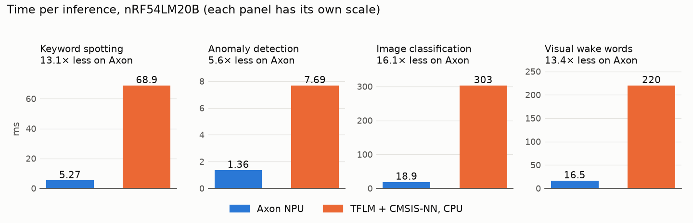

# Bench of the Axon NPU against TFLM

A second app that measures the time, the current and the charge of one inference on the
nRF54LM20B. It runs the four [MLPerf Tiny](https://github.com/mlcommons/tiny) reference models two
ways, from the same `.tflite`:

| Backend | How the model runs |
|---|---|
| Axon | Compiled by Nordic's [Axon compiler](https://github.com/nrfconnect/sdk-edge-ai/blob/v3.0.0/doc/axon_compiler/Axon_npu_tflite_compiler.rst), run on the NPU |
| TFLM | [TensorFlow Lite Micro](https://github.com/tensorflow/tflite-micro) with [CMSIS-NN](https://github.com/ARM-software/CMSIS-NN) kernels, run on the Cortex-M33 at 128 MHz |

A [Power Profiler Kit II](https://www.nordicsemi.com/Products/Development-hardware/Power-Profiler-Kit-2)
(PPK2) captures the current. [zephyr-ppk2](https://github.com/rdagher/zephyr-ppk2) marks the
inference in the firmware and reports it. [ppk2-lib](https://github.com/rdagher/ppk2-lib) drives
the PPK2.

Measured on one dev kit with one PPK2. See [Limitations](#limitations) for what was not checked.

## Results

Measured on one nRF54LM20 DK with one PPK2, in Ampere meter mode at the kit's current-measurement
header, at 100,000 samples per second. Each capture starts from a power cycle.

| Model | Backend | Time | Mean current | Charge, median | Charge, mean ± sd | Regions |
|---|---|---:|---:|---:|---:|---:|
| Keyword spotting | Axon | 5.270 ms | 3,228 µA | 16.30 µC | 17.0 ± 1.8 µC | 207 |
| | TFLM | 68.854 ms | 2,309 µA | 158.97 µC | 158.98 ± 0.10 µC | 205 |
| Anomaly detection | Axon | 1.362 ms | 3,382 µA | 4.57 µC | 4.61 ± 0.27 µC | 222 |
| | TFLM | 7.686 ms | 2,348 µA | 18.014 µC | 18.049 ± 0.096 µC | 423 |
| Image classification | Axon | 18.868 ms | 2,757 µA | 51.93 µC | 52.02 ± 0.98 µC | 166 |
| | TFLM | 303.001 ms | 2,373 µA | 719.07 µC | 719.03 ± 0.36 µC | 69 |
| Visual wake words | Axon | 16.451 ms | 2,823 µA | 46.48 µC | 46.43 ± 0.65 µC | 172 |
| | TFLM | 219.995 ms | 2,322 µA | 510.3 µC | 510.9 ± 1.0 µC | 90 |

A region is one inference: the stretch where the marker is high. "mean ± sd" is the mean and the
standard deviation of the charge over the regions of one capture.

| Model | Time, TFLM / Axon | Charge, TFLM / Axon |
|---|---:|---:|
| Keyword spotting | 13.1 | 9.8 |
| Anomaly detection | 5.6 | 3.9 |
| Image classification | 16.1 | 13.8 |
| Visual wake words | 13.4 | 11.0 |

The charge ratio is that of the medians.




Between two inferences the firmware sleeps for 50 ms. The median current there is 1.44 to 1.49 µA
in the eight captures.

The figures come from [`results/*.txt`](results), as printed by `west ppk2 attribute`. The
captures themselves, 47 to 105 MB each, are not in the repository.

## Measurement

- The marker is raised just before the inference call and dropped just after it:
  `PPK2_TRACE_SCOPE` in [`src/main.c`](src/main.c). The figures are those of the whole device
  under test (DUT) while the marker is high.
- Axon: one `nrf_axon_nn_model_infer_sync()` call. It includes NPU power-up and locking, the
  input copy, the NPU run, the softmax on the CPU where the model has one, the output copy and
  power-down.
- TFLM: the input copy, `Invoke()` and the output copy.
- The median of the charge is used, not the mean. When the DUT wakes from sleep, the PPK2 can
  read tens of mA too high for 40 µs, which moves the mean of a short region. See zephyr-ppk2's
  [limitations](https://github.com/rdagher/zephyr-ppk2/blob/main/docs/limitations.md#wake-up-bursts).
- No energy is given. A PPK2 measures current, and the charge follows from it with no assumption.
  An energy needs the supply voltage, which the capture does not contain. At a constant voltage
  the energy ratio is the charge ratio.
- The measurement firmware has no UART: [`quiet.conf`](quiet.conf).

## Limitations

Tested with nRF Connect SDK v3.4.1, add-on v3.0.0, TFLM at `fcc760a`, zephyr-ppk2 at `a5fbce7` and
ppk2-lib 0.1.0, from macOS 26.5.

- One dev kit, one PPK2, one capture per configuration: 12 s for Axon, 25 s for TFLM.
- The inputs are three random vectors per model, from
  [`model/make_test_data.py`](../model/make_test_data.py). No dataset is involved, so nothing
  here is about accuracy.
- Axon's outputs are bit exact against the outputs the Axon compiler computed on the host, for
  the four models.
- TFLM's outputs are close to those, not identical: the two implementations round differently.
  With random inputs one difference is large: an output of image classification is -69 with TFLM
  and -128 with Axon. Agreement on real data was not checked.
- This compares two ways to deploy a model on this chip. It does not measure the NPU alone:
  TFLM is an interpreter, and code written for the CPU by hand could be faster.
- `--vdd 3.3` was given to the captures. In Ampere meter mode it feeds the PPK2's calibration.
  The supply voltage of the DUT was not measured.
- A capture taken in the same session as the flash reads high: after a flash the chip stays in
  debug mode until it is power-cycled. The median charge was then 3 to 8 % above the figures
  given here, and the idle current 36 to 39 µA.

## Reproduction

Docker and a PPK2 are required, with the [requirements](../README.md#requirements) of the main
README. On the host, install these in the environment `west` runs from:

```sh
pip install west ppk2-lib pyelftools matplotlib
```

Wire the bench as follows. See zephyr-ppk2's
[bench](https://github.com/rdagher/zephyr-ppk2/blob/main/docs/bench.md) page for the kit's header.

- the PPK2 at the kit's current-measurement header, in Ampere meter mode;
- `D0` of the logic port to P1.12;
- `GND` to the kit's ground;
- `VCC` to the kit's supply.

With the PPK2 in the supply path, the debug port answers only while the PPK2 passes power.
`west ppk2 run` and `west ppk2 power on --hold` do that.

To build, measure and draw, run:

```sh
just compile                  # the four models, into model/outputs/
just bench axon mlperf_kws    # or tflm; mlperf_ad, mlperf_ic, mlperf_vww
just measure axon_kws         # flash, then capture 12 s from a power cycle, and report
python3 bench/plot.py         # the two figures, from bench/results/*.txt
```

`just measure axon_kws` ends with the report:

```console
captured 1200000 samples over 12.00 s (100012 Hz)
capture: 1199018 samples, 11.99 s powered
D0 infer               n=207   width     5.272 ms  avg   3262.61 µA  peak    16802 µA  charge    17.200 ± 2.020 µC (median 16.303)
idle (no channel high) median      1.49 µA  mean     28.53 µA
```

To check the outputs over the UART, hold the power on in another terminal with
`west ppk2 power on --hold`, then:

```sh
just bench tflm mlperf_kws verify
just flash
just monitor
```

## Files

| File | Content |
|---|---|
| [`src/main.c`](src/main.c) | The loop: marker, inference, comparison with the expected output |
| [`src/axon.c`](src/axon.c), [`src/tflm.cc`](src/tflm.cc) | The two backends |
| `axon.conf`, `axon.overlay`, `tflm.conf` | What each backend needs |
| `quiet.conf` | UART off, for measuring |
| `boards/` | The marker pin |
| [`plot.py`](plot.py) | The figures |

## See also

- [zephyr-ppk2](https://github.com/rdagher/zephyr-ppk2): marking code, the `west ppk2` commands,
  reading a report.
- [ppk2-lib](https://github.com/rdagher/ppk2-lib): the `ppk2` command and library, the wirings of
  both modes.
