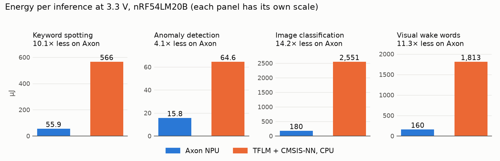

# Bench: Axon NPU against TFLM on the CPU

Time and energy of one inference on the nRF54LM20B, for the four
[MLPerf Tiny](https://github.com/mlcommons/tiny) reference models, run two ways from the same
`.tflite`:

- **Axon**: compiled by Nordic's Axon compiler, run on the NPU;
- **TFLM**: TensorFlow Lite Micro with CMSIS-NN kernels, run on the Cortex-M33 at 128 MHz.

The current is captured with a [PPK2](https://www.nordicsemi.com/Products/Development-hardware/Power-Profiler-Kit-2).
[zephyr-ppk2](https://github.com/rdagher/zephyr-ppk2) marks the inference in the firmware and
reports it; [ppk2-lib](https://github.com/rdagher/ppk2-lib) drives the PPK2.

## Results

nRF54LM20 DK, PPK2 in Ampere meter mode across the kit's current-measurement header, 3.3 V,
100 000 samples per second. Mean over n inferences; charge as mean ± standard deviation.

| Model | Backend | Time | Mean current | Charge | Energy | n |
|---|---|---:|---:|---:|---:|---:|
| Keyword spotting | Axon | 5.269 ms | 3.21 mA | 16.939 ± 0.231 µC | 55.9 µJ | 219 |
| | TFLM | 68.804 ms | 2.49 mA | 171.587 ± 0.302 µC | 566.2 µJ | 211 |
| Anomaly detection | Axon | 1.360 ms | 3.51 mA | 4.774 ± 0.178 µC | 15.8 µJ | 236 |
| | TFLM | 7.685 ms | 2.55 mA | 19.576 ± 0.169 µC | 64.6 µJ | 434 |
| Image classification | Axon | 18.857 ms | 2.89 mA | 54.539 ± 0.742 µC | 180.0 µJ | 176 |
| | TFLM | 302.975 ms | 2.55 mA | 772.986 ± 1.145 µC | 2 550.9 µJ | 71 |
| Visual wake words | Axon | 16.436 ms | 2.95 mA | 48.559 ± 0.356 µC | 160.2 µJ | 182 |
| | TFLM | 219.895 ms | 2.50 mA | 549.264 ± 0.654 µC | 1 812.6 µJ | 92 |

| Model | Time, TFLM / Axon | Energy, TFLM / Axon |
|---|---:|---:|
| Keyword spotting | 13.1 | 10.1 |
| Anomaly detection | 5.7 | 4.1 |
| Image classification | 16.1 | 14.2 |
| Visual wake words | 13.4 | 11.3 |




The reports these figures come from are in `results/*.txt`, as printed by `west ppk2 attribute`.
The captures themselves (about 100 MB each) are not committed.

Between inferences the firmware sleeps for 50 ms; the median current there is 36 to 39 µA in all
eight captures.

## What is measured

- The marker is raised just before the inference call and dropped just after it
  (`PPK2_TRACE_SCOPE` in `src/main.c`). The figures are those of the whole chip while it is high.
- Axon: `nrf_axon_nn_model_infer_sync()`, which includes NPU power-up and locking, the input copy,
  the NPU run, the CPU softmax where the model has one, the output copy and power-down.
- TFLM: the input copy, `Invoke()` and the output copy.
- The PPK2 measures current. Energy is the charge times 3.3 V, taken as constant.
- The measurement firmware has no UART (`quiet.conf`).

## What is compared, and what is not

- Both backends run the same `.tflite`, on the same inputs: three random vectors per model,
  generated by `model/make_test_data.py`. No dataset is involved, so this says nothing about accuracy.
- Axon's outputs are bit exact against the outputs the Axon compiler computed on the host, for all
  four models.
- TFLM's outputs are close to those but not identical: the two implementations round differently.
  With random inputs some differences are not small (image classification, one output: −69 against −128).
  Agreement on real data was not checked.
- This is a comparison of two ways to deploy a model on this chip. It is not a measurement of the
  NPU alone: TFLM is an interpreter, and a hand-optimised CPU implementation could be faster.
- One board, one capture per configuration, 12 to 25 s each.

## Reproduce

Needs the main README's set-up, Docker, a PPK2, and on the host, in the environment `west` runs from:

```sh
pip install west ppk2-lib pyelftools matplotlib
```

Wiring ([zephyr-ppk2 bench page](https://github.com/rdagher/zephyr-ppk2/blob/main/docs/bench.md)):
PPK2 across the DK's current-measurement header, logic port `D0` to P1.12, `GND` to ground,
`VCC` to the board's supply. With the PPK2 in the supply path the debug port answers only while
the PPK2 passes power, which `west ppk2 run` and `west ppk2 power on --hold` do.

```sh
just compile                          # the four models, into model/outputs/
just bench axon mlperf_kws            # or tflm; mlperf_ad, mlperf_ic, mlperf_vww
just measure axon_kws                 # flash, capture 15 s, report
python3 bench/plot.py                 # the two figures, from bench/results/*.txt
```

To check the outputs over the UART instead: `west ppk2 power on --hold` in another terminal, then
`just bench tflm mlperf_kws verify`, `just flash`, `just monitor`.

## Files

| File | Content |
|---|---|
| `src/main.c` | the loop: marker, inference, comparison with the expected output |
| `src/axon.c`, `src/tflm.cc` | the two backends |
| `axon.conf`, `axon.overlay`, `tflm.conf` | what each backend needs |
| `quiet.conf` | UART off, for measuring |
| `boards/` | the marker pin |
| `plot.py` | the figures |
