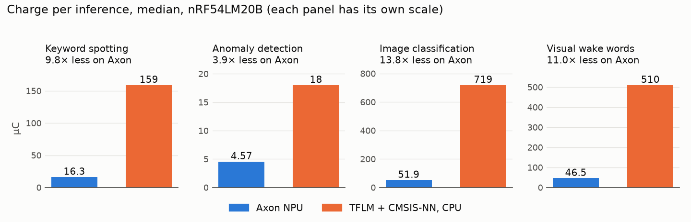

# Bench: Axon NPU against TFLM on the CPU

Time and energy of one inference on the nRF54LM20B, for the four
[MLPerf Tiny](https://github.com/mlcommons/tiny) reference models, run two ways from the same
`.tflite`:

- **Axon**: compiled by Nordic's Axon compiler, run on the NPU;
- **TFLM**: TensorFlow Lite Micro with CMSIS-NN kernels, run on the Cortex-M33 at 128 MHz.

The current is captured with a [PPK2](https://www.nordicsemi.com/Products/Development-hardware/Power-Profiler-Kit-2).
[zephyr-ppk2](https://github.com/rdagher/zephyr-ppk2) marks the inference in the firmware and
reports it; [ppk2-lib](https://github.com/rdagher/ppk2-lib) drives the PPK2.

## Results

nRF54LM20 DK, PPK2 in Ampere meter mode across the kit's current-measurement header, supply
voltage given as 3.3 V, 100 000 samples per second. Each capture starts from a power cycle, after
the flash, so the chip is not in debug mode.

| Model | Backend | Time | Mean current | Charge, median | Charge, mean ± sd | Energy | n |
|---|---|---:|---:|---:|---:|---:|---:|
| Keyword spotting | Axon | 5.270 ms | 3.23 mA | 16.303 µC | 17.013 ± 1.778 µC | 53.8 µJ | 207 |
|  | TFLM | 68.854 ms | 2.31 mA | 158.974 µC | 158.979 ± 0.104 µC | 524.6 µJ | 205 |
| Anomaly detection | Axon | 1.362 ms | 3.38 mA | 4.568 µC | 4.607 ± 0.273 µC | 15.1 µJ | 222 |
|  | TFLM | 7.686 ms | 2.35 mA | 18.014 µC | 18.049 ± 0.096 µC | 59.4 µJ | 423 |
| Image classification | Axon | 18.868 ms | 2.76 mA | 51.934 µC | 52.025 ± 0.977 µC | 171.4 µJ | 166 |
|  | TFLM | 303.001 ms | 2.37 mA | 719.069 µC | 719.031 ± 0.362 µC | 2 372.9 µJ | 69 |
| Visual wake words | Axon | 16.451 ms | 2.82 mA | 46.475 µC | 46.433 ± 0.652 µC | 153.4 µJ | 172 |
|  | TFLM | 219.995 ms | 2.32 mA | 510.311 µC | 510.855 ± 1.049 µC | 1 684.0 µJ | 90 |

| Model | Time, TFLM / Axon | Charge, TFLM / Axon |
|---|---:|---:|
| Keyword spotting | 13.1 | 9.8 |
| Anomaly detection | 5.6 | 3.9 |
| Image classification | 16.1 | 13.8 |
| Visual wake words | 13.4 | 11.0 |

The PPK2 measures current, so the result is a charge. Energy is the median charge times 3.3 V,
taken as constant; the energy ratio is the charge ratio. The median is used because a wake-up from
sleep can read tens of mA too high for 40 µs
([zephyr-ppk2 limitations](https://github.com/rdagher/zephyr-ppk2/blob/main/docs/limitations.md#wake-up-bursts)),
which moves the mean of a short region: 17.0 against 16.3 µC for keyword spotting on Axon.




The reports these figures come from are in `results/*.txt`, as printed by `west ppk2 attribute`.
The captures themselves (about 100 MB each) are not committed.

Between inferences the firmware sleeps for 50 ms; the median current there is 1.44 to 1.49 µA in the
eight captures.

## What is measured

- The marker is raised just before the inference call and dropped just after it
  (`PPK2_TRACE_SCOPE` in `src/main.c`). The figures are those of the whole chip while it is high.
- Axon: `nrf_axon_nn_model_infer_sync()`, which includes NPU power-up and locking, the input copy,
  the NPU run, the CPU softmax where the model has one, the output copy and power-down.
- TFLM: the input copy, `Invoke()` and the output copy.
- The measurement firmware has no UART (`quiet.conf`).

## What is compared, and what is not

- Both backends run the same `.tflite`, on the same inputs: three random vectors per model,
  generated by `model/make_test_data.py`. No dataset is involved, so this says nothing about accuracy.
- Axon's outputs are bit exact against the outputs the Axon compiler computed on the host, for all
  four models.
- TFLM's outputs are close to those but not identical: the two implementations round differently.
  With random inputs some differences are not small (image classification, one output: −69 against −128).
  Agreement on real data was not checked.
- This is a comparison of two ways to deploy a model on this chip. It is not a measurement of the
  NPU alone: TFLM is an interpreter, and a hand-optimised CPU implementation could be faster.
- One board, one capture per configuration, 12 s (Axon) or 25 s (TFLM).
- A first set of captures, taken in the same powered session as the flash, read 5 to 8 % higher:
  after flashing, the chip stays in debug mode until it is power-cycled.

## Reproduce

Needs the main README's set-up, Docker, a PPK2, and on the host, in the environment `west` runs from:

```sh
pip install west ppk2-lib pyelftools matplotlib
```

Wiring ([zephyr-ppk2 bench page](https://github.com/rdagher/zephyr-ppk2/blob/main/docs/bench.md)):
PPK2 across the DK's current-measurement header, logic port `D0` to P1.12, `GND` to ground,
`VCC` to the board's supply. With the PPK2 in the supply path the debug port answers only while
the PPK2 passes power, which `west ppk2 run` and `west ppk2 power on --hold` do.

```sh
just compile                          # the four models, into model/outputs/
just bench axon mlperf_kws            # or tflm; mlperf_ad, mlperf_ic, mlperf_vww
just measure axon_kws                 # flash, then capture 12 s from a power cycle, and report
python3 bench/plot.py                 # the two figures, from bench/results/*.txt
```

To check the outputs over the UART instead: `west ppk2 power on --hold` in another terminal, then
`just bench tflm mlperf_kws verify`, `just flash`, `just monitor`.

## Files

| File | Content |
|---|---|
| `src/main.c` | the loop: marker, inference, comparison with the expected output |
| `src/axon.c`, `src/tflm.cc` | the two backends |
| `axon.conf`, `axon.overlay`, `tflm.conf` | what each backend needs |
| `quiet.conf` | UART off, for measuring |
| `boards/` | the marker pin |
| `plot.py` | the figures |
